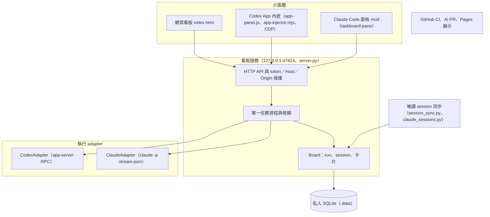
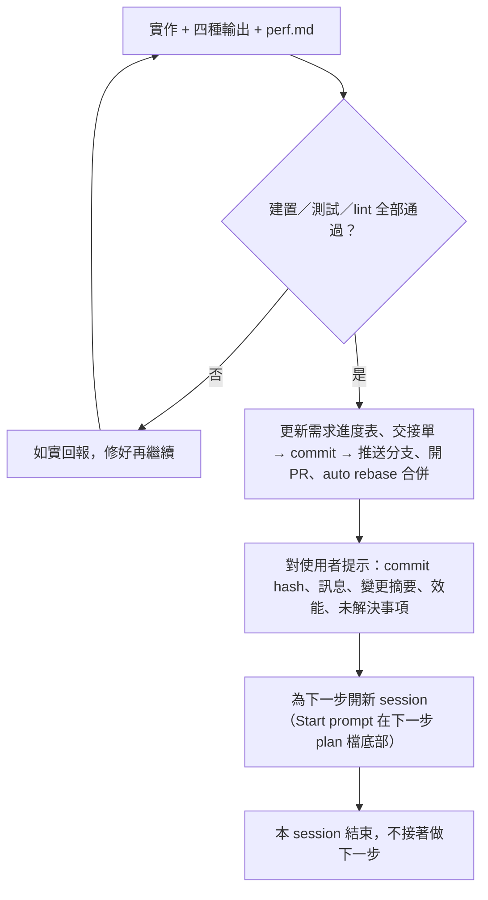

# TaskBoardTool — 總體計畫（Master Plan）

> 進度：[current-status.md](current-status.md)（需求進度表）｜ 架構：[architecture.md](architecture.md) ｜ 決策：[decisions.md](decisions.md) ｜ 工作規則：[../AGENTS.md](../AGENTS.md)
> 建立日期：2026-10-21（導入 AI 結構 2.0.0 時依 README、AI_CONTEXT、architecture 回填；專案本身自 2026-10-10 開發）。本檔回答「整個專案要做什麼、不做什麼、分幾步做」；每一步的細節在 `docs/plan/<ID>-<slug>.md`，目前做到哪在 `docs/current-status.md`。

## 修改紀錄

| 日期 | 修改者 | 說明 |
|---|---|---|
| 2026-10-21 | Claude Code (Sonnet 5.5) | 導入 AI 結構 2.0.0 時建立，內容依 README、AI_CONTEXT、architecture 與需求進度表回填（ADR-025） |

## 1. 要做什麼

TaskBoardTool 是 Windows 本機的 AI 任務看板：同一套 SQLite、排程與網頁介面，把任務派給已安裝的 Codex app-server 與 Claude Code CLI，讓使用者在同一個看板上排隊、追蹤、對話與人工驗收。專用 Codex App profile 以 CDP 嵌入看板；Claude 側是 CLI 整合與 Claude Code 的側邊窗格 mod（看板不內嵌於 Claude App，可用 Browser 窗格或瀏覽器開啟）。也能唯讀同步本機既有的 Codex／Claude session，讓使用者看到所有進行中的對話。

給誰用：在本機同時使用 Codex 與 Claude Code 的個人開發者（目前一位使用者）。成功的樣子：AI 說完成不算完成，使用者把卡片移到「已完成」才算（待審核欄）；一次只執行一張卡片；不複製認證資料、不改官方 App、不動真實任務資料。

**這一版不做**：

- 不內嵌到 Claude App 側欄（只有 Browser 窗格附掛與 Claude Code mod 窗格）。
- 不做多人、雲端或遠端存取；服務只監聽 `127.0.0.1`。
- 不涵蓋雲端、其他主機與 subagent 的 session。
- 不做截止日期、阻塞關係欄位與工作流欄位；Git 分支／worktree 綁定尚未實作（需求進度表 R25，待使用者決定）。
- 不引入 npm build 或前端框架；唯一外部前端函式庫是 Mermaid（由安裝腳本下載並核對雜湊，ADR-019）。
- 不自動修改官方 App 安裝檔，不複製登入資料。

## 2. 架構總覽

介面層只透過本機 HTTP API 與看板服務溝通；排程只認 `ToolAdapter` 介面，不直接知道 Codex 或 Claude 的協定；既有 session 以唯讀方式投影成追蹤卡片，不寫入 SQLite、不派工。細節（依賴方向、模組切分）放 [architecture.md](architecture.md)，各模組職責放 `AI_CONTEXT.md`「重要目錄」。

### 為什麼這樣切（目的／原因／效果）

| 切分 | 目的 | 原因 | 效果 |
|---|---|---|---|
| `ToolAdapter` 介面後放 Codex 與 Claude | 同一個看板派給兩種工具 | 兩者協定不同（RPC 與 stream-json），排程不該知道差異（ADR-006） | 新增工具只需實作 adapter；任務、run、session 以 `(tool, id)` 為鍵 |
| 唯讀 session 同步與派工分開 | 看到所有既有對話又不污染任務資料 | 寫入 SQLite 會產生重複派工與髒資料（ADR-003、ADR-009） | 追蹤卡片不佔排程鎖，使用者明確建立派工卡片後才能送後續需求 |
| Claude App 對話以鏡像 run 進看板 | App 內的對話也能在看板驗收 | App 對話不是看板派的，不能走排程（ADR-017） | 鏡像卡不佔單一任務鎖、不被排程領走 |
| 前端與 helper 分離，API token 留在 helper | 嵌入 Codex App 時守住信任邊界 | iframe 是 opaque origin（`AI_CONTEXT.md` 限制） | capability、來源 frame、parent 驗證保留 |
| 本機服務與 GitHub 自動化分開 | 展示與 CI 不碰真實資料 | Pages 只能是靜態展示（ADR-022） | 展示用範例資料層，不含 Python、SQLite、Secrets |

## 3. SOLID 對應

| 原則 | 在本專案的落實方式 |
|---|---|
| S | 新功能放新模組（`attachments.py`、`folder_picker.py`、`plan_import.py`、`claude_sessions.py`）；`server.py` 與 `index.html` 是既有大檔，不因清單而重構 |
| O | 新增執行工具是新 adapter 加註冊，不改排程邏輯；新增 API 路由沿用既有保護 |
| L | `CodexAdapter` 與 `ClaudeAdapter` 對外同一介面；測試用 `tests/fake_claude_cli.py` 模擬 CLI |
| I | `ToolAdapter` 只暴露模型、派工、事件、核准、對話所需的方法 |
| D | 排程與 Board 依賴 `ToolAdapter` 抽象；具體 adapter 在服務啟動時建立 |

以上是現況的對應，不代表既有程式已完全符合；實際符合程度以 [architecture.md](architecture.md) 與程式碼為準。

## 4. 效能策略與測試

效能目標沒有集中的預算表；已知的量測散見於 changelog：HTTP 改 keep-alive 與 16 KB 分段 flush 後大回應 80/80 通過（ADR-007）、Claude transcript 以檔尾逐步放大視窗讀取（真實 258 MB 檔 0.6 秒）、`/api/models` 60 秒快取。新的效能改善依 `engineering-workflow.md` 的「基準 → 量測 → 瓶頸 → 最佳化 → 再量測」，並寫入對應步驟的 `perf.md`。

測試分類與驗證指令見 `AI_CONTEXT.md`「建置與測試」：Python unittest（`tests/test_taskboard_*.py`）、Node 測試（主題、Markdown、Mermaid、展示、AI 自動化）、隔離 DOM 測試、需要專用 Codex App 的 `taskboard-app.test.mjs`、`claude plugin validate/test`、結構與模型路由檢查。CI 在 ubuntu 與 windows 跑 `node scripts/ci/check.mjs` 與結構檢查，另有展示瀏覽器測試。

## 5. 實作步驟

本專案沒有預先排好的步驟：功能由使用者逐次提出，開發順序與狀態以 `docs/current-status.md` 的需求進度表為準（R01–R21 已完成，依 changelog 與 git log 回填）。之後跨多個 session 的功能依 `docs/plan/_template.md` 建立計畫檔，並在本表新增一列。

| 步驟 | 層級 | 主題 | 關鍵產出 | 主要量測 |
|---|---|---|---|---|
| R01–R05 | 底層／介面 | 看板基礎、屬性與模型、雙工具與計畫匯入、Claude 窗格 mod、拖曳與自動審核 | 看板服務、adapter、嵌入入口、窗格 mod | 後端單元測試、實際 App 回歸 |
| R06–R09 | 發行／介面 | GitHub 快照發布、登入帳號名稱、Claude App 對話鏡像、Markdown 與 Mermaid 回報 | 公開 repository、鏡像卡、回報渲染 | 隔離服務與真實 App 事件 |
| R10–R15 | 修正 | 嵌入看板連線、標題跟隨、心智圖、auto 權限、第一次提問、倒回對話 | 穩定性修正與 Session 心智圖 | 可控重現（Debugger.pause）、單元測試 |
| R16–R17 | 文件／發行 | 操作手冊與影片、GitHub AI PR／CI／Pages | `docs/user-guide.md`、CI、Pages 展示 | CI run、Chrome 展示操作 |
| R18–R21 | 介面／系統 | 專案篩選與附件、worktree 專案名、群組「未分組」、開機自動啟動 | 附件 API、watchdog | Python 82–84 項、真實 App 讀取 |
| R22 | 雜項 | 導入 AI 結構 2.0.0 | 需求進度表、ADR 資料夾、本檔 | 結構檢查四項 |
| R23–R25 | 待處理 | baseline 測試失敗、驗證缺口、Git 綁定 | 待使用者決定 | |

為什麼這個順序：先有看板與工具整合（R01–R05），再補發行與使用者面的功能（R06–R09），之後以修正與穩定性為主；順序依使用者需求而非預排。

## 6. 每一步的輸出規範（4 種輸出形式）

適用範圍：Step Protocol 的步驟與進度表中類型為「功能」的需求；小修正免。範本在 [steps/_template/](steps/_template/)。2.0.0 之前完成的功能不補（ADR-025）。

| 輸出 | 用法 | 檔案 |
|---|---|---|
| 寫作 Writing | ASD-STE100 風格英文寫 Purpose／Reason／Effect，附繁中摘要；`tools/ste-lint.mjs` 檢查句長與被動語態 | `spec.md` |
| 圖解 Diagrams | Mermaid 結構圖、流程圖、序列圖、狀態圖 | `diagram.md` |
| 互動網頁 Web pages | 單檔 HTML，把概念變成能操作的小 App | `explainer.html` |
| 解說影片 Explainer videos | 一定交付分鏡腳本；實際影片是選配，要使用者同意 | `storyboard.md` |

**誠實說明**：STE-lint 只檢查句長與簡單的被動語態，不是完整的 ASD-STE100 驗證；影片是分鏡而非成片。

## 7. 每完成一步：commit、提示、開新 session

本專案的 `main` 由 PR 的 rebase 合併進入，所以第 5 步用 `project-rules.md`「Git」的授權流程（分支、PR、`--auto --rebase`），不做本機 `merge --no-ff` 與 tag。

為什麼每步開新 session：每個步驟的上下文很大且彼此獨立；新 session 只靠 `AGENTS.md`、`docs/current-status.md` 與該步 plan 檔就能接手，不被前一步的雜訊拖累。

## 8. 風險與待決策

| # | 風險／問題 | 對策 | 何時處理 |
|---|---|---|---|
| 1 | Claude control 協定與 transcript 格式是內部格式，無公開文件，依本機 CLI 2.1.283 實測，版本更新可能失效 | 升級 CLI 後重跑 `tests/fake_claude_cli.py` 相關測試與真實握手；不宣稱未驗證的行為 | 每次升級 Claude CLI |
| 2 | Codex App 大改版可能使 DOM／CSS 選擇器與 CDP 注入失效 | `tests/taskboard-app.test.mjs` 回歸；`app-injector.mjs` 逾時只記 `renderer-busy` 不重建 | App 更新後 |
| 3 | `server.py`、`index.html` 單檔過大，變更風險高 | 新功能放新模組；大改前先加測試 | 持續 |
| 4 | 本機 `python` 可能是失效的 Store alias，測試靜默結束 | 用 `py -3`（見 `AI_CONTEXT.md`） | 持續 |
| 5 | 驗證缺口（窗格下拉、重開機自動啟動、核准往返、Claude 角色實際 model／effort） | 需求進度表 R24，排人工驗收 | 待使用者決定 |
