# 目前架構

## 回報 Markdown 與 Mermaid 渲染（2026-10-12）

修改前：run 結果、session 回報、聊天紀錄的回報段落與狀態列表的完成訊息都以 `el()`／`createTextNode` 放進 `pre-wrap` 方塊，Markdown 與 Mermaid 只顯示原始碼。

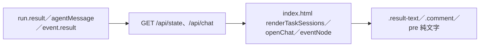

修改後：同一批位置改呼叫 `mdBox`／`mdRender`；轉換器只建立元素與文字節點。已關閉的 ```mermaid 區塊先顯示原始碼，再經 `api()` 懶載入函式庫（網頁版 fetch＋X-Board-Token、Codex 內嵌版 postMessage→app-injector RPC，同一路徑）；使用者訊息維持純文字。

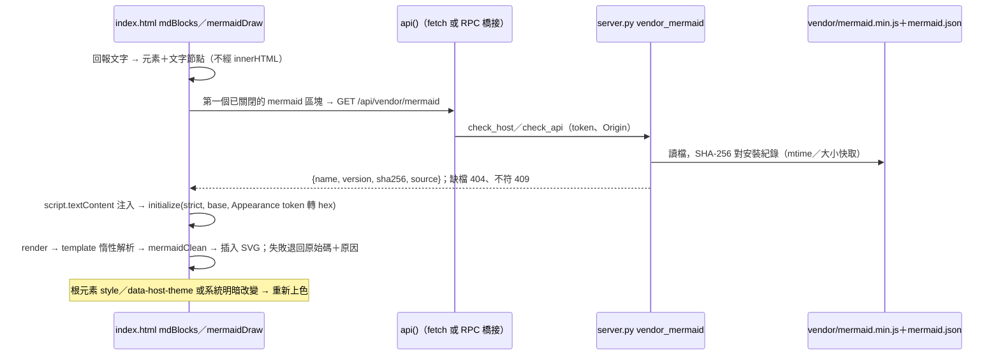

安裝流程：函式庫不進 Git，由腳本下載固定版本。

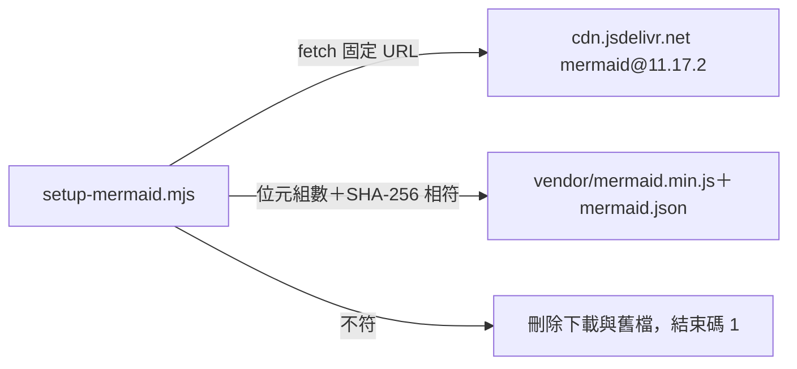

## Claude App 對話鏡像（2026-10-12）

修改前：Claude App 的 session 只經 claude_sessions 索引投影成唯讀卡片，欄位等於訊號狀態；要操作必須「建立派工卡片」，固定進列管。

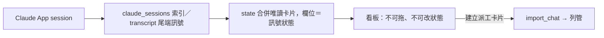

修改後：mod 把回合事件送到看板，卡片跟著回合走；唯讀投影只剩沒有鏡像卡片的 session。

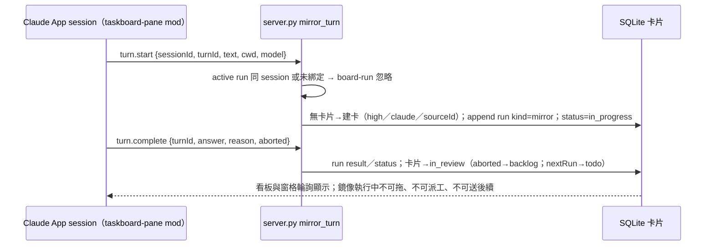

擬稿補充（同日）：建卡時簡介以 transcript 最早一句播種（`brief=seed`），start 回應 `wantsBrief`／`briefSource`；mod 以 `$.model.complete`（haiku／low）擬「需求簡介＋驗收條件」送 `event=brief`，只在 `seed`／`drafted` 接受；`update` 改 description → `manual`，之後拒絕。服務重啟的復原跳過最後一筆為 `mirror` 的進行中卡片。

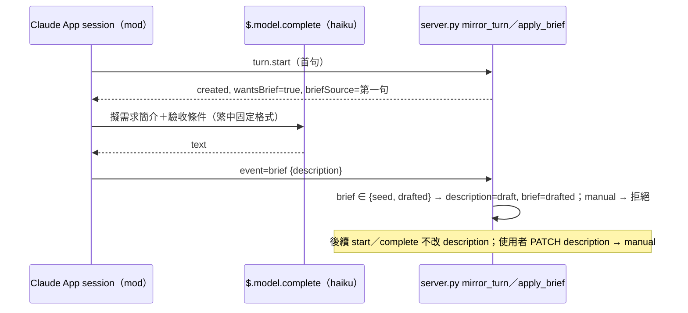
## Claude App 外掛安裝快照同步（2026-10-11）

Observed Fact：App 安裝的 `hooks/register.tsx`／`types/index.d.ts` 與舊提交 `2a2609d` 一致，安裝目錄不是連結；只修改專案不會自動更新。
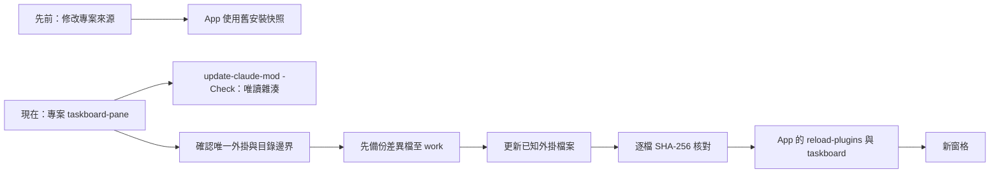
僅部署自有外掛程式、型別、manifest 與測試，保留產生的 tsconfig，不修改官方 App、登入或 SQLite。雜湊／模擬 UI 通過不等於當前 App 畫面已熱載入。

## 專案候選與 Windows 資料夾選擇（2026-10-11）

修改前：專案與路徑只能文字輸入；新增時僅依專案篩選器推算單一路徑。
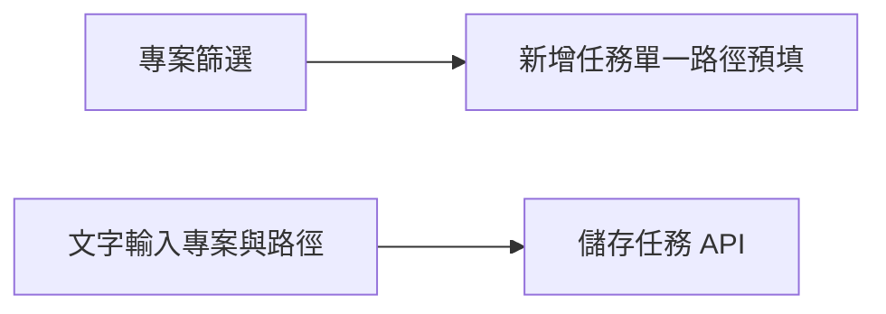
修改後：網頁 input＋datalist、Claude 窗格 Select＋Input，從現有 state 投影專案／路徑，不新增專案資料表；`backlog` 只更名為「列管」。
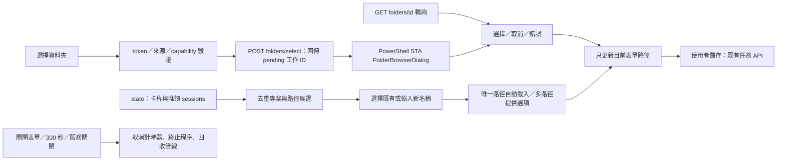
資料夾工作只保存在服務記憶體，無任務資料庫寫入；初始路徑以 argv 傳遞，不組 shell 指令；僅接受存在的絕對目錄結果。視窗期間 HTTP／派工不持有 Board 鎖；同時僅一個選擇視窗。前端以表單世代與原欄位值避免延遲結果覆蓋新草稿。標準 API bridge 不需新增權限或延長每次請求逾時。

## 卡片滑鼠拖曳（2026-10-11）

修改前：瀏覽器原生 drag/drop；輪詢不分拖曳狀態重建卡片。
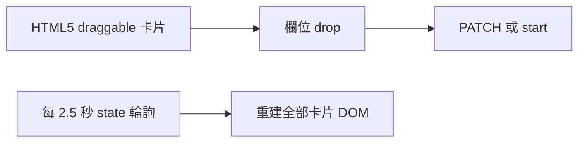
修改後：滑鼠拖曳只處理 UI，資料與派工仍走原有 API／capability bridge；輪詢保留來源 DOM。
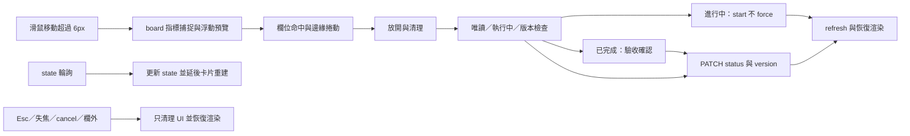

## 共用執行介面與 Claude Code adapter（2026-10-11）

修改前：Board 直接綁定 Codex RPC，派工、事件、核准、對話閱讀與 session 同步都只認 Codex thread ID。
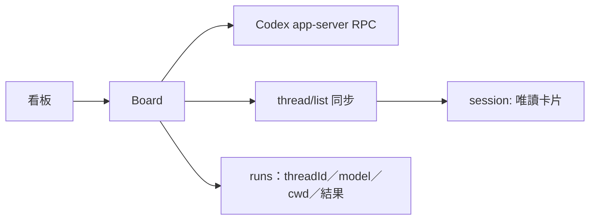
修改後：Board 保留 SQLite、單一排程、run snapshot、共用的 `complete_run`／`set_progress`／`bind_session`／`set_turn`，派工細節交給 `adapters[tool]`。任務與 run 帶 `tool`、`sourceTool`；去重與延續鍵為 (tool, id)。
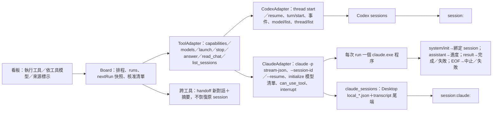
邊界：Codex thread/start、thread/resume、turn/start 皆指定 approvalsReviewer=auto_review，保留 approvalPolicy=on-request、workspace-write 與 networkAccess=false；原生審核可拒絕，HTTP 核准清單不無條件回答 accept。Claude 程序以 run 的 cwd 啟動、`acceptEdits`＋看板核准；所有管線 loopback／stdio；Claude session 只讀 claude-code-sessions（Store 版實際位於 `%LOCALAPPDATA%\Packages\Claude_*\LocalCache\Roaming\Claude\`，其次 `%APPDATA%\Claude\`）與 `~/.claude/projects`，不寫入、不派工。看板網頁不嵌入 Claude App；`.claude/launch.json` 讓 Claude App 的 Browser 窗格附掛服務；`claude-mod/taskboard-pane` 以 Claude Code mods 在 App 內停靠原生窗格（`$.http.fetch` 讀同一 API、`$.ui.open` 停靠、`$.clock.every` 5 秒輪詢），核心仍在 server.py。

## 右側任務屬性與相關議題（2026-10-10）

修改前：左側屬性、固定 Codex 執行設定；卡片彼此沒有關聯。
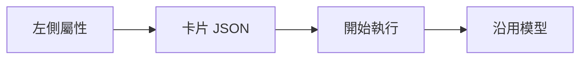
修改後：日期與右側欄位，labels／model 保存於 task body；舊資料只在讀取加預設值。獨立 models API 不進 state 與 scheduler，60 秒快取、分頁完成才發布；啟動驗證非空所選模型可用，thread/start／resume 與 turn/start 明確傳 model，run 保存本次選擇。
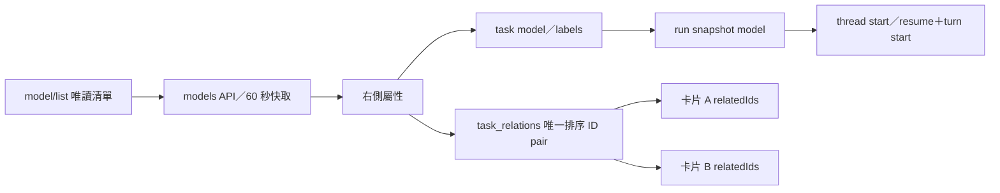
關聯變更與 task 寫入同一 SQLite commit；對端 version／updatedAt 變動，舊草稿拒絕覆蓋；刪除任一端同步刪除關聯。Store.all／get 唯讀投影 relatedIds，普通 run／留言寫入不重寫關聯。schema 新增空 table 不遷移任務內容；export schemaVersion=3，API=1.3.0。關聯僅查閱，不改派工順序。工作流不新增；Git 開發上下文綁定仍未實作，現有 cwd 保留。

server.py：SQLite 卡片、HTTP API、單一任務 scheduler、Codex app-server RPC。app-injector：只接專用 profile，CDP 文件載入隔離 iframe。app-panel：入口、可見工作區、選取與主題 bridge；index.html：看板與 capability API。
start-app 驗證埠／profile、啟動或重用服務與 App，再啟動 helper；helper 登錄 reload 腳本。stop-app 移除入口、bridge 並恢復 CSP bypass。一般 App 不受影響。

## 修改前
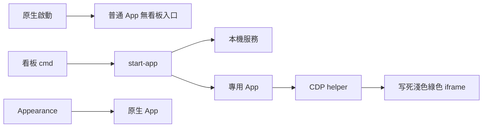

## 修改後
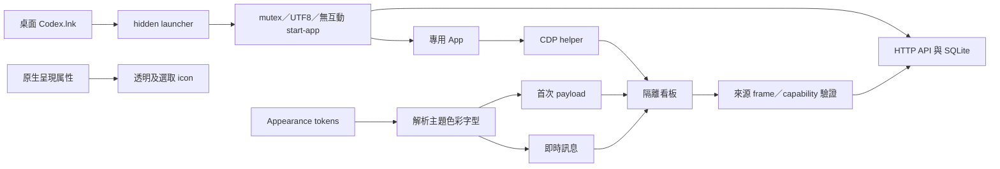

邊界：CDP／HTTP 皆 loopback；iframe opaque origin；theme 固定 CSS key 白名單；私人執行資料排除 Git。

## 任務詳情與多 session（2026-10-10）

修改前：卡片只有 sourceId、workerThreadId 與最新 result，重試清空最新結果；state/import 只以這兩個 ID 去重。詳情是編輯表單，唯讀追蹤卡片直接開聊天。
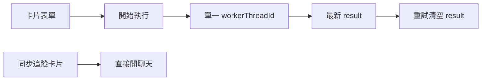

修改後：SQLite JSON body 增加 runs 與 nextRun，不換資料表。舊卡片僅在讀取時投影 legacy run，正常寫入時才保存新欄位；不背景重寫 DB。每次 start 在 board lock 內 snapshot 本次需求／cwd／ID，才清空最新 result。RPC 建立／resume 對話，turn 事件依 thread 與 turn ID 更新本輪；完成／失敗／中止／斷線／重啟時固定保存 run 的結果。歷史 run 不再修改。
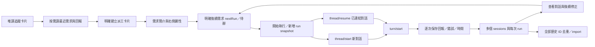

後續需求空白／不屬於卡片的 thread／stale version／同卡片執行中／已有後續需求均拒絕；排隊時不 RPC。外部活躍訊號阻擋續跑，scheduler 跳過該卡片讓其他待辦繼續。延續用該 run 的 cwd，新對話用任務 cwd，留白則執行時建立專用資料夾並回存路徑。新對話帶原需求與最近三次回報、最多 30000 字，並非自動複製完整對話。來源閱讀保留既有最近 20 回合界線，前端 100 筆 brief 快取不落 DB。初版為 export schemaVersion=2／API version=1.2.0；目前欄位與版本見上方右側屬性章節。

## Session 同步（2026-10-10）

修改前：清單只由手動更新載入，匯入的積壓卡片不反映來源後續狀態。
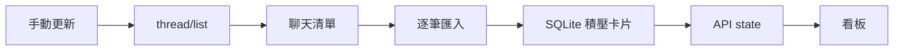

修改後：sync_sessions 每輪完成後等 15 秒；thread/list 分頁唯讀 metadata、不 resume／turn/start。SessionSignals 限定 CODEX_HOME/sessions，只讀 JSONL 尾端 256 KiB，依大小／mtime 快取。sync lock 合併並行更新，board lock 僅發布快照時持有，state 不等 RPC。每輪最多 3000 筆，更多明列 hasMore。
```mermaid
flowchart LR
 Timer[背景每 15 秒] --> List[唯讀 thread/list]
 List --> Signals[受限尾端回合訊號] --> Cache[記憶體快照與時間／錯誤]
 DB[SQLite 派工卡片] --> State[API state 合併與來源 ID 去重]
 Cache --> State --> UI[唯讀追蹤卡片與來源狀態]
 UI --> Read[唯讀聊天紀錄]
 DB --> Scheduler[既有 scheduler]
```

RPC active 用 runtime；其他 App 通常是 notLoaded，改以紀錄有限推論。task_complete 待審核，turn_aborted／未知積壓；task_started 或 item_completed 在 10 分鐘內才標近期活動。訊號逾期、同步錯誤或快照超過 60 秒降為待確認，保留上次清單。追蹤卡片不落 DB、不進 scheduler／備份；保存卡片只附 sessionStatus，不覆寫欄位／狀態。不能判定其他視窗是否開啟或成果已驗收。
