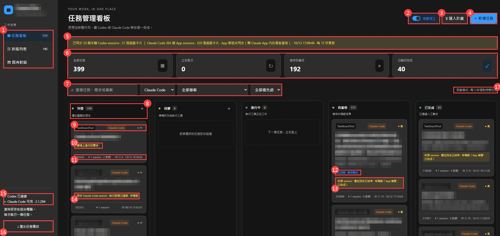
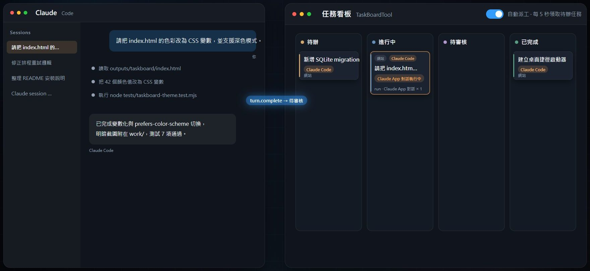
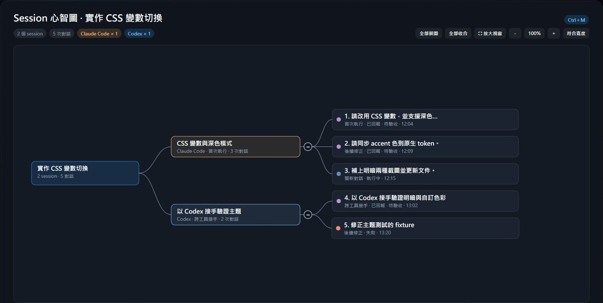

# TaskBoardTool 操作手冊

本機任務看板，讓 **Codex** 與 **Claude Code** 共用同一套卡片、排程、對話紀錄與人工驗收。本手冊依「安裝 → 啟動 → 操作 → 進階功能 → 排錯」分章說明；技術細節與不變條件見 `AI_CONTEXT.md`，安裝與整合的背景說明見 `outputs/taskboard/README.md`。

## 45 秒功能展示

<video src="../work/promo-video/TaskBoardTool-promo-45s.mp4" controls poster="images/promo-poster.jpg" width="960"></video>

[](../work/promo-video/TaskBoardTool-promo-45s.mp4)

影片檔：[work/promo-video/TaskBoardTool-promo-45s.mp4](../work/promo-video/TaskBoardTool-promo-45s.mp4)（GitHub 網頁版不會內嵌播放，點連結後在檔案頁面播放或下載）。六段內容依序對應本手冊：集中管理任務（第 4、5 章）→ Session 自動同步成卡片（第 6 章）→ 對話分類顯示（第 7 章）→ Session 心智圖（第 8 章）→ 從計畫到執行（第 9 章）→ 成果追蹤與驗收（第 5.4 節）。影片來源與重新產生方式見 `work/promo-video/README.md`。

---

## 1. 總覽

| 概念 | 說明 |
|---|---|
| 卡片 | 一項要交給 AI 的工作，含需求、驗收條件、執行工具、模型、專案與工作資料夾 |
| 五個欄位 | **列管**（想法與尚未排程的卡片）→ **待辦**（排隊等派工）→ **進行中**（AI 正在執行）→ **待審核**（AI 回報完成，等你驗收）→ **已完成**（你驗收通過） |
| 執行工具 | 每張卡片指定 **Codex** 或 **Claude Code**，兩者共用同一個看板與排程，一次只執行一張卡片 |
| run | 看板的一次派工紀錄：需求、session、時間、結果與回報；同一張卡片可累積多次 run |
| session | AI 工具端的對話（Codex thread／Claude Code session）；一張卡片可連結多個 session，一個 session 可有多次 run |
| 待審核 | 看板的核心原則：AI 說完成不算完成，**你移到已完成才算完成** |

看板本體是一個只監聽 `127.0.0.1:47824` 的本機服務，介面為繁體中文、時間為台北時區。資料全部存在 `outputs/taskboard/.data/`（SQLite、設定、token），不進 Git。

---

## 2. 安裝

### 2.1 共同環境（兩種工具都需要）

| 項目 | 需求 | 備註 |
|---|---|---|
| 作業系統 | Windows 10／11，PowerShell 5.1 | 腳本為 PowerShell 與 WSH，不支援 macOS／Linux |
| Python | 3.9 以上 | 看板服務本體；只用標準函式庫。若 `python` 是 Microsoft Store 的空殼別名（執行後沒有輸出），改用 `py -3` |
| Node.js | 22 以上 | Codex App 整合 helper、Claude mod 安裝腳本、Mermaid 安裝腳本（已驗證 Node 24） |
| Git | 任一版本 | 取得專案與更新 |
| 瀏覽器 | Chrome／Edge 任一 | 網頁版看板 |

取得專案後，所有指令都在**專案根目錄**執行：

```powershell
git clone <repo 網址> D:\CodexWork\TaskBoardTool
cd D:\CodexWork\TaskBoardTool
```

選用：回報中的 ```mermaid 圖需要 Mermaid 函式庫（不在 Git 內，每台電腦、每個 worktree 各裝一次）：

```powershell
node outputs/taskboard/setup-mermaid.mjs
node outputs/taskboard/setup-mermaid.mjs --check
```

### 2.2 Codex 側需要安裝什麼

| 項目 | 說明 |
|---|---|
| Microsoft Store 版 **Codex App** | 安裝並以你的帳號登入。看板的 Codex 派工透過 App 附帶的 `codex app-server`，沒有額外 API Key；啟動器會自動在 `%LOCALAPPDATA%\OpenAI\Codex\bin` 找到 `codex.exe`，找不到時看板仍可啟動但不能派 Codex（先開一次 Codex App 即可） |
| 桌面捷徑（選用） | 執行下列指令在桌面建立「Codex」捷徑，之後雙擊即可一次啟動看板服務、專用 Codex 視窗與整合 helper |

```powershell
powershell.exe -NoProfile -ExecutionPolicy Bypass -File outputs/taskboard/install-desktop-shortcut.ps1
```

Codex 的專用視窗使用獨立 App profile 與只聽 `127.0.0.1` 的除錯埠 9232，把看板嵌入 App 左側導覽；不改官方安裝檔、不複製登入資料。

### 2.3 Claude Code 側需要安裝什麼

| 項目 | 說明 |
|---|---|
| **Claude Code CLI** | 看板以 CLI 整合（`claude -p …`）派工。安裝後務必登入，否則派工會以「Failed to authenticate」失敗 |
| **Claude App**（選用） | 想在 Claude App 的 Code 分頁旁看到看板窗格、或讓 App 的對話自動鏡像成卡片，就需要安裝下方的看板 mod |

```powershell
npm install -g @anthropic-ai/claude-code
claude auth login
```

安裝看板 mod（複製到 `~/.claude/mods/taskboard-pane` 並登記到 `~/.claude/settings.json`）：

```powershell
node outputs/taskboard/setup-claude-mod.mjs
node outputs/taskboard/setup-claude-mod.mjs --check
```

- 設定只對**新啟動**的 session 生效：重開 Claude App 或開新 session 後窗格自動出現。
- 之後 `git pull` 更新專案，重跑同一支腳本即同步（已載入的 session 會熱重載）。
- 腳本同時回報 Node／Python／Claude CLI／Codex 是否齊全，並以 `claude plugin validate` 做靜態檢查，不耗模型額度。

### 2.4 確認安裝完成

```powershell
node outputs/taskboard/setup-claude-mod.mjs --check
node outputs/taskboard/setup-mermaid.mjs --check
powershell.exe -NoProfile -ExecutionPolicy Bypass -File outputs/taskboard/start.ps1
```

瀏覽器開啟 `http://127.0.0.1:47824` 看到五欄看板即完成。新電腦的看板是空白的（資料庫不在 Git 內）。

---

## 3. 啟動與停止

| 使用情境 | 指令或動作 | 結果 |
|---|---|---|
| 網頁版（最通用） | `powershell.exe -NoProfile -ExecutionPolicy Bypass -File outputs/taskboard/start.ps1` | 啟動服務並開瀏覽器；加 `-NoBrowser` 只啟服務；`-Port 47825` 換埠 |
| Codex App 專用視窗 | 雙擊桌面「Codex」捷徑、`開啟 Codex 看板.cmd`，或 `outputs/taskboard/start-app.ps1` | 啟動（或重用）服務，開專用 Codex 視窗，左側「New chat」下方多出「任務看板」入口，點了在主工作區顯示看板 |
| Claude App 內 | 開任一 Code session，窗格自動停靠；關閉後輸入 `/taskboard`、按輸入框上方「▦ 任務看板」列，或在空的輸入框按 **9** 重開 | 窗格顯示卡片、徽章、核准請求與常用按鈕；完整操作仍用網頁版（可在 Claude App 的 Browser 窗格開 `http://127.0.0.1:47824`，專案的 `.claude/launch.json` 已提供 `taskboard` 設定） |
| 停止服務 | `outputs/taskboard/stop.ps1` | 正在執行的任務會中斷並保留在待審核，其他卡片與紀錄保留 |
| 移除 Codex 視窗整合 | `outputs/taskboard/stop-app.ps1` | 移除側欄入口與嵌入頁面、停止 helper；不關閉其他 Codex 視窗、不停止看板服務 |

注意事項：

- 看板必須由本機服務提供，**不能直接雙擊 `index.html`**。
- 服務停止、電腦休眠或關機時不會派工；重新啟動時未確認結束的任務會進待審核，不會重複執行。
- 服務或 helper 曾停止時，重新執行啟動器即可恢復，不需關閉原本的 Codex 視窗。

---

## 4. 介面導覽



| 編號 | 位置 | 說明 |
|---|---|---|
| 1 | 左側導覽 | **任務看板**（五欄主畫面）、**狀態列表**（時間軸、錯誤與核准請求，數字為紀錄數）、**既有對話**（本機 Codex／Claude session 清單） |
| 2 | 自動派工開關 | 開啟時每 5 秒領一張待辦卡片；關閉改為手動「開始執行」 |
| 3 | 匯入計畫 | 貼上計畫 JSON，一次建立多張有依賴的列管卡片（第 9 章） |
| 4 | 新增任務 | 開啟新卡片表單（第 5.1 節） |
| 5 | 同步橫幅 | 既有對話同步結果：Codex session 數、Claude App session 數、追蹤卡片數、App 群組是否已同步、更新時間 |
| 6 | 統計卡 | 全部任務／正在執行／等待你驗收／已驗收完成 |
| 7 | 搜尋與篩選 | 搜尋、工具篩選（全部／Codex／Claude Code）、專案篩選（依工具分組）、優先級篩選 |
| 8 | 欄位標頭 | 欄名、卡片數與一句說明；列管與待辦的「＋」直接在該欄新增卡片 |
| 9 | 卡片標籤列 | 專案名、執行工具標籤（Codex 藍、Claude Code 橘）、優先級 |
| 10 | 卡片徽章 | 卡片目前需要什麼：請補上需求、等待前置卡片、下一個執行、排隊 #n、等待你核准或回答 |
| 11 | 卡片頁尾 | 卡片 ID、「◎ N session · M 對話」按鈕（開 Session 心智圖，第 8 章）、狀態紀錄數、最後更新時間 |
| 12 | 已回報 · 等待驗收 | AI 已回報完成，等你拖到已完成（第 5.4 節） |
| 13 | 來源 session 狀態 | 卡片連結的 session 最近訊號：回合已結束、近期有執行訊號、待確認，Claude App 卡片附 App 摘要 |
| 14 | 同步 session 徽章 | 唯讀同步卡片：先「建立派工卡片」才能派工或移動（第 6.2 節） |
| 15 | 工具連線狀態 | Codex app-server 與 Claude Code CLI 是否可用與版本 |
| 16 | 匯出任務備份 | 下載已保存卡片的 JSON 備份 |
| 17 | 派工模式提示 | 目前為自動或手動模式 |

### 4.1 左側導覽

| 項目 | 用途 |
|---|---|
| ▦ 任務看板 | 五欄看板主畫面 |
| ☷ 狀態列表 | 時間軸：完成訊息、錯誤、驗收紀錄，以及 **需要你核准或回答的請求** |
| ☏ 既有對話 | 本機未封存的 Codex sessions 與 Claude App 的 Code sessions，每 15 秒自動同步；可「查看對話」或「建立派工卡片」 |
| ↓ 匯出任務備份 | 下載已保存卡片的 JSON 備份（不含唯讀同步卡片） |
| ⇪ 匯入計畫 | 貼上計畫 JSON，一次建立多張有依賴關係的列管卡片（見第 9 章） |
| ＋ 新增任務 | 開啟新卡片表單 |

### 4.2 工具列

- **搜尋**：比對標題、需求、專案與工具名。
- **工具篩選**：全部工具／Codex／Claude Code；專案選單會依工具分組。
- **專案篩選**、**優先級篩選**（緊急／高／中／低）。
- **自動派工開關**：預設開啟，每 5 秒領取一張待辦卡片；右側提示目前模式。

### 4.3 卡片上的資訊

- 專案名、執行工具標籤（Codex 藍、Claude Code 橘）、優先級、模型。
- 徽章：「下一個執行」「排隊 #n」「等待前置卡片」「等待你核准或回答」「已回報 · 等待驗收」「Claude App 對話執行中」「同步 session · 唯讀」。
- 頁尾「◎ N session · M 對話」按鈕：開啟該卡的 Session 心智圖（第 8 章）。

---

## 5. 任務卡片操作

### 5.1 新增卡片

按「＋ 新增任務」，欄位如下：

| 欄位 | 說明 |
|---|---|
| 任務標題 | 卡片名稱 |
| 需求與驗收條件 | 交給 AI 的完整需求；建議寫清楚「做什麼」與「怎樣算完成」 |
| 狀態 | 新卡片只能放列管或待辦 |
| 優先級 | 緊急／高／中／低；排程先比優先級 |
| 執行工具 | Codex 或 Claude Code |
| 負責人（執行模型） | 由工具的真實模型清單讀取（Codex `model/list`、Claude CLI 握手），留白沿用工具自己的設定 |
| 推理強度 | Claude Code 專用（low／medium／high／xhigh 等），啟動前依模型支援等級驗證 |
| 標籤 | 逗號或頓號分隔，最多 20 個 |
| 專案名稱 | 可選既有名稱或輸入新名稱；唯一對應資料夾會自動帶入，同名多路徑需選擇 |
| 工作資料夾 | 直接輸入，或按「選擇資料夾…」開 Windows 視窗（300 秒逾時，取消保留原值） |
| 成果連結 | 可填 PR、文件等網址 |

儲存後卡片右側才會出現**相關議題**（雙向連結）與**前置卡片**（第 9 章）。創建日期自動保存、不可修改。

### 5.2 派工：讓卡片開始執行

| 方式 | 規則 |
|---|---|
| 自動派工（預設） | 每 5 秒從待辦領一張：先比優先級，同優先級依進入待辦的先後（卡片離開再回來排到後面）；一次只跑一張；被前置阻擋的卡片跳過 |
| 卡片內「開始執行」 | 手動立即派工；若此刻有別張卡片在執行或前置未完成，會留在待辦並提示 |
| 拖曳到「進行中」 | 等同開始執行，遵守同樣規則 |
| 「複製指令」 | 把需求複製成指令，自己貼到 Codex／Claude 手動執行 |

派工時才會建立或延續 AI 對話；儲存卡片、排入待辦都不會動到對話，也不耗額度。

### 5.3 執行中

- 卡片顯示在「進行中」，詳情的「目前執行回報」即時更新進度。
- **需要核准或回答時**，狀態列表與 Claude 窗格會出現請求：Codex 採原生 `auto_review` 自動審核工具操作（workspace-write、網路預設關閉，受限操作仍可能被拒絕）；Claude Code 採 `auto` 權限模式，例行工具由安全分類器自動核准，仍要確認的才送到看板。
- 「停止執行」先送中斷訊號，逾時才結束程序；停止後卡片回到列管。
- 執行中的卡片不能拖曳、不能改狀態、不能送後續需求。

### 5.4 待審核與驗收

- AI 回報完成後卡片移到**待審核**，狀態列表與畫面提示會通知。
- 打開卡片檢視回報與對話，確認成果後把卡片**拖到「已完成」**（需確認）。這一步就是人工驗收。
- 失敗／中止：卡片保留原需求與結果，錯誤顯示在卡片與狀態列表；額度限制錯誤會留在待辦、10 分鐘後自動重試，其他錯誤留給人工處理（重新派工採卡片目前的模型與推理強度）。
- 驗收時卡片上的舊錯誤訊息會一併清除。

### 5.5 成果不符：後續需求／再次對話

卡片詳情下方「後續需求／再次對話」：

1. **對話方式**（三選一）
   - **延續既有對話**：以同一個工具接續同一個 session，AI 保有先前脈絡。只能用原本的工具。
   - **開新對話**：同工具開新 session，自動帶入原需求與最近三次回報（上限 30,000 字）。
   - **跨工具接手**：改用另一個工具開新對話並帶入摘要，不會假裝恢復原 session。
2. 填寫哪裡尚未符合需求。
3. **送出後**：「排入待辦」（依優先級與排隊順序自動執行）或「立即開始執行」。
4. 排隊中的後續需求固定保存工具、模型、推理強度與資料夾，要改請先「取消排隊」。

「留言與補充需求」留在卡片中，重新排入待辦時會一起交給執行工具。聊天紀錄視窗內的「延續這個對話」也能直接送出後續需求。

### 5.6 其他操作

- **拖曳**：按住卡片拉到另一欄放開即保存；靠近左右邊緣自動捲動；Esc 或放到看板外取消。
- **刪除**：卡片詳情內的「刪除」；相關議題與前置關係會同步清除。
- **匯出任務備份**：JSON（schemaVersion 5），含 runs 與關聯；不含唯讀同步卡片。

---

## 6. 任務卡片與 Session 的連動關係

### 6.1 一張卡片、多個 session、多次 run

卡片詳情下方「對話與執行回報」依 **session** 分組，每個 session 列出：第一次提問（純文字）、「另有 N 次延續對話」、最後一筆錯誤，以及「查看對話」按鈕。每次派工都是一筆 run，run 的類型標示它與 session 的關係：

| run 類型 | 何時產生 | 與 session 的關係 |
|---|---|---|
| 首次執行 | 卡片第一次派工 | 建立新 session |
| 後續修正 | 選「延續既有對話」送出後續需求 | 同一 session 再跑一回合 |
| 開新對話 | 選「開新對話」 | 同工具新 session，帶原需求與最近三次回報 |
| 跨工具接手 | 選「跨工具接手」 | 另一工具的新 session，帶摘要 |
| 再次執行 | 失敗或中止後重新派工 | 依當時選擇延續或新建 |
| Claude App 對話 | Claude App 的 session 鏡像（6.3） | 每個回合一筆 run |

session 以 (工具, id) 識別：同一個 session 不會重複建卡，延續也只能用同工具。

### 6.2 既有對話：唯讀同步卡片 → 派工卡片

- 「既有對話」每 15 秒同步本機未封存的 Codex sessions 與 Claude App 的 Code sessions（Store 版 Claude App 的檔案在 `%LOCALAPPDATA%\Packages\Claude_*\LocalCache\Roaming\Claude\claude-code-sessions`，看板會自動尋找）。
- 看板會把這些 session 顯示為 **唯讀同步卡片**（標籤「同步 session · 唯讀」）：可閱讀最近 20 回合，不能拖曳、不會自動派工、不寫入資料庫、不包含在備份內。
- 要接手這個對話：按「**建立派工卡片**」，卡片進入列管並連結來源 session；補上需求、移到待辦後才派工。預設開獨立的新對話；只有你在「對話方式」選延續來源對話，執行時才續跑原 session。
- 封存的 session 不列出；來源 session 封存後唯讀卡片下輪消失，已建立的派工卡片保留。

### 6.3 Claude App 對話自動鏡像成卡片

安裝看板 mod 後，你在 Claude App 裡的每個 Code session 會自動變成看板卡片：



| 時機 | 看板行為 |
|---|---|
| session 第一句送出（`turn.start`） | 自動建卡，直接進**進行中**，優先級高、工具 Claude Code、綁定 session；標題先用首句第一行，需求簡介以首句播種 |
| 每個回合 | 一筆「Claude App 對話」run；卡片徽章「Claude App 對話執行中」，期間不能拖曳、改狀態、派工或送後續需求 |
| 回合結束（`turn.complete`） | 卡片進**待審核**；若被中止→列管；若已排有後續需求→待辦；已完成的卡片會重開 |
| App 幫 session 命名或你在 App 改名 | 卡片標題跟著 App 標題；但你在看板改過標題後就不再覆寫 |
| 需求簡介 | mod 會用 haiku 擬一份「需求簡介＋驗收條件」草稿；你編輯過簡介後永不覆寫，後續回合也不改簡介 |
| App 倒回對話（rewind） | App 會換新的 session id；看板把原卡改綁新 id、把舊 id 的 run 併入，不另建卡 |

鏡像卡片不佔「一次一張」的執行鎖，排程也不會領它；看板自己派出的 Claude run 不會再被鏡像一次。

### 6.4 專案名稱從哪裡來

- 看板卡片：你填的專案名稱／資料夾。
- Codex 同步卡片：session 的工作資料夾名。
- Claude App 卡片：App 側欄的**群組名**（例如「交易工具」）。群組不存在於磁碟檔案，由 Claude App 內的看板窗格讀取後回報；沒在 App 內開過窗格時只會顯示資料夾名。

### 6.5 執行訊號

其他 App 視窗是否正在跑同一個 session 無法精確得知，看板以 session 檔案尾端的訊號判斷：10 分鐘內有活動標「近期有執行訊號」、較舊未結束標「待確認」。外部活躍訊號會阻擋續跑同一 session，但不保證其他 App 不會同時執行。

---

## 7. 卡片中的對話訊息分類顯示

按卡片 session 區塊或既有對話的「查看對話」打開**聊天紀錄**：

| 元素 | 說明 |
|---|---|
| 回合摺疊 | 每個回合一個可展開區塊，摘要列顯示「回合 N · 狀態 · 首句摘要 · 時間」；預設只展開最新回合 |
| **你**（藍底、藍色左框） | 你送出的需求與後續需求，純文字顯示 |
| **進度**（灰字、虛線左框） | AI 執行途中的狀態與工具使用紀錄 |
| **回報**（淺底） | AI 的回報內容，以 Markdown 顯示（標題、清單、表格、程式碼），```mermaid 區塊畫成圖並跟隨主題配色；Mermaid 未安裝時顯示原始碼與安裝提示 |
| 延續這個對話 | 視窗底部直接填寫後續需求並送出（同一工具接續同一 session） |

卡片詳情的 session 區塊只顯示每個 session 的**第一次提問**與「另有 N 次延續對話」；完整的進度與回報一律在聊天紀錄閱讀。狀態列表的完成訊息同樣以 Markdown 顯示。

---

## 8. Session 心智圖

### 8.1 它表達什麼

一張卡片可能歷經多個 session（首次執行、開新對話、跨工具接手、來源對話、Claude App 鏡像），每個 session 又有多次 run。心智圖以三層把這些關係畫成一張圖：

```
卡片 ─┬─ session A（Claude Code · 首次執行 · 3 次對話）─┬─ 1. 首次執行 · 已回報 · 待驗收
      │                                                 ├─ 2. 後續修正 · 已回報 · 待驗收
      │                                                 └─ 3. 開新對話 · 執行中
      └─ session B（Codex · 跨工具接手 · 2 次對話）──────┬─ 4. 跨工具接手 · 已回報
                                                        └─ 5. 後續修正 · 失敗
```



- **根節點**：卡片標題、session 數與對話總數。
- **session 節點**：依工具分色（Codex 藍、Claude Code 橘），標示類別（來源對話／首次執行／後續對話）與對話次數。
- **對話節點**：編號、需求摘要、run 類型、狀態（色點：執行中藍、已回報紫、失敗紅）與時間。

### 8.2 開啟方式

- 卡片頁尾「◎ N session · M 對話」按鈕。
- 卡片詳情「對話與執行回報」旁的「◎ Session 心智圖」。
- 快捷鍵 **Ctrl＋M**（Mac 為 Cmd＋M）：滑鼠指著卡片、用 Tab 選到卡片，或已開啟卡片詳情時按下即開啟；再按一次關閉。

### 8.3 互動

| 操作 | 效果 |
|---|---|
| 點 session 節點 | 開啟該 session 的聊天紀錄 |
| 點對話節點 | 關閉心智圖、跳到卡片詳情中那一筆回報並短暫標示；延續 run 直接開對話 |
| 點根節點 | 開啟卡片詳情 |
| session 右側 ＋／－ | 收合或展開該 session 的對話（收合狀態依卡片記在頁面記憶體） |
| 全部展開／全部收合 | 一次處理所有 session |
| －／百分比／＋／符合寬度 | 縮放 30%～300%，百分比按鈕回 100%；畫布內 Ctrl＋滾輪以游標為中心縮放，拖曳平移 |
| ⛶ 放大視窗 | 心智圖視窗放大到近全螢幕 |

說明：沒有看板 run 的 session（唯讀同步卡片、來源對話）開圖時會讀最近 20 回合計算對話數，超過顯示「20+」；單一 session 超過 12 次對話只畫最近 11 次加一個「較早 N 次」節點；派工時未建立對話的 run 歸在「未建立對話」。

---

## 9. 從計畫到執行：計畫匯入與前置依賴

### 9.1 流程

1. 把一個功能展開成多個事項，為每個事項指定工具與角色，標出先後關係。
2. 匯入看板：每個事項成為一張**列管**卡片，依依賴順序建立。
3. 依賴關係讓排程自動接力：前置卡片**全部驗收完成（已完成欄）**後，被阻擋的卡片自動排入待辦並留言，自動派工接著執行。

### 9.2 計畫 JSON 格式

```json
{
  "name": "深色模式", "project": "網站", "cwd": "C:\\path\\to\\repo", "tool": "claude",
  "items": [
    {"key": "tokens", "title": "定義色彩 token", "description": "…驗收條件…", "role": "developer"},
    {"key": "css", "title": "套用深色樣式", "role": "developer-deep", "dependsOn": ["tokens"]},
    {"key": "docs", "title": "更新文件", "tool": "codex", "dependsOn": ["tokens"], "priority": "low"}
  ]
}
```

- `dependsOn` 以 `key` 指向前置事項；循環依賴會被拒絕。
- Claude Code 事項以 `role` 自動對應模型與推理強度（可用 `model`／`effort` 覆蓋）；Codex 事項只保存角色標籤，模型沿用 Codex 設定。

| role | model | effort | 適用 |
|---|---|---|---|
| fast-worker | haiku | low | 明確唯讀查詢 |
| developer | sonnet | medium | 既有架構的一般實作 |
| developer-deep | sonnet | high | 複雜或驗證成本高的低風險實作 |
| architect | opus | high | 高風險分析與計畫 |
| architect-deep | opus | xhigh | 高風險且高度不確定的分析 |

### 9.3 三種匯入途徑

| 途徑 | 做法 |
|---|---|
| 網頁看板 | 左側「⇪ 匯入計畫」貼上 JSON，按「建立卡片」 |
| 終端機／Codex | `py -3 outputs/taskboard/plan_import.py plan.json`（只接受 loopback 看板網址） |
| Claude Code 對話 | 請它呼叫看板工具 `import_plan`（需已安裝看板 mod） |

匯入只建立卡片，不派工、不耗額度。

### 9.4 手動管理前置

- 卡片詳情右側「前置卡片（需先完成）」可加入或移除；被阻擋的卡片顯示「等待前置卡片」，排程與「開始執行」都會跳過。
- 前置還在待審核但想先跑後續卡片：卡片內「略過前置，開始執行」（需確認，會在留言記錄略過了哪些前置）。自動派工永遠不會略過前置。
- 「相關議題」只是雙向連結，不影響排程。

---

## 10. Claude App 內的看板窗格

| 功能 | 說明 |
|---|---|
| 自動停靠 | session 開始時在 Code 分頁旁出現；關閉後用 `/taskboard`、輸入框上方「▦ 任務看板」列或空輸入框按 **9** 重開 |
| 顯示 | 派工卡片、工具徽章、核准請求、執行狀態 |
| 按鈕 | 重新整理、自動／手動派工、開始執行、停止、驗收完成、核准／拒絕、略過前置執行、開啟完整看板 |
| ＋ 新增任務 | 標題、單行需求、執行工具、模型、優先級、列管／待辦、專案、工作資料夾，可「建立並開始執行」 |
| 背景工作 | 回報 Claude App 群組名作為專案名；把 session 回合鏡像成卡片（第 6.3 節）；提供 `import_plan` 工具 |

限制：mod 只能畫原生元件，沒有網頁內嵌；完整的新增任務、後續需求與對話閱讀仍在網頁版。

---

## 11. 常見問題與排錯

| 現象 | 原因與處理 |
|---|---|
| `python` 執行後沒有任何輸出 | Microsoft Store 的空殼別名；改用 `py -3`，或安裝 python.org 版本 |
| Claude 派工失敗「Failed to authenticate」 | CLI 未登入：終端機執行 `claude auth login` 後重新派工 |
| 啟動器警告找不到 Codex | 先開一次 Microsoft Store 的 Codex App，讓 `codex.exe` 出現在 `%LOCALAPPDATA%\OpenAI\Codex\bin` |
| 埠被佔用 | `start.ps1 -Port 47825`；專用視窗除錯埠衝突用 `start-app.ps1 -DebugPort 9233`（先關舊的專用視窗） |
| Claude App 沒有看板窗格 | 重跑 `setup-claude-mod.mjs` 並檢查 `--check`；設定只對新 session 生效，重開 App 或開新 session |
| 既有對話橫幅「資料未找到」 | 橫幅附有實際檢查的路徑；確認 Claude App 已開過 Code session，或 Codex 已有 session |
| 回報裡的 Mermaid 只顯示原始碼 | 執行 `node outputs/taskboard/setup-mermaid.mjs`；雜湊不符會自動刪除並報錯 |
| 服務重啟後卡片在待審核但沒有回報 | 重啟時未確認結束的 run 標為中止／失敗；Claude App 鏡像卡在回合結束訊號到達後會自癒 |
| 唯讀卡片不能拖 | 同步 session 卡片唯讀；先「建立派工卡片」 |
| 模型選單是空的 | 工具未安裝或未登入；清單由真實來源讀取，60 秒快取 |

---

## 12. 資料與安全

- `outputs/taskboard/.data/`（SQLite、設定、token、App profile）與 `work/`（截圖、備份、隔離資料）不進 Git；請勿上傳。
- 服務只監聽 `127.0.0.1`；API 需要頁面內嵌的 token，Codex App 嵌入另有來源 frame 與 capability 檢查。
- 看板不改官方安裝檔、不複製登入資料；Codex 整合只接已驗證的專用 profile。
- 更新專案後：`git pull` → 重跑 `setup-claude-mod.mjs`（Claude mod）→ 必要時 `setup-mermaid.mjs` → 重啟服務（`stop.ps1` 後 `start.ps1`，或重新執行桌面捷徑）。
